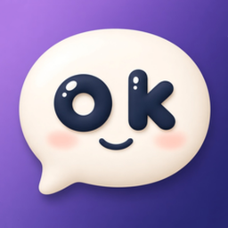

<h1>
  
  OkBot
</h1>

<p>
  <strong>English</strong> · <a href="./README_zh.md">中文</a>
</p>

[](https://github.com/shuzheng/okbot/releases/latest)
[](https://github.com/shuzheng/okbot/releases)
[](https://github.com/shuzheng/okbot/stargazers)
[](https://github.com/shuzheng/okbot/releases)

**OkBot — a real Personal Agent.**  
AI as permanent contacts (persona + memory & evolution), real tools with optional human-in-the-loop, durable long-running tasks, schedules, Squad + Mesh collaboration, a self-hosted personal gateway (`okbot serve`), multi-computer execution, and a marketplace with `.okbot` packs. Bring your own models; security and observability built in.

## Features

- **Long-running tasks** — auto-decompose into steps, persist progress, resume after interrupts, auto-correct and keep going, manage multiple open tasks
- **Self-hosted personal gateway** — `okbot serve` (+ client attach) on your machine or LAN, optional Web UI
- **Multiple run computers** — local by default; register remote hosts via `sandbox-agent` so one gateway reaches many machines
- **Member auto-collaboration** — **Squads** (captain orchestration) on tasks you assign; **Mesh** so 1:1 assistants can ask roster peers
- **Cross-session memory & evolution** — facts persist across chats; silent post-turn refresh of persona / skills / memory so assistants evolve with use
- **BYO models · security · observability** — providers you already use; optional HITL (most tools auto-allow out of the box), path & command soft guards (not an OS sandbox), token permissions; light token stats and run traces
- **Marketplace & assistant packs** — in-app marketplace for starter assistants and connectors; export / import `.okbot` packs, or import from public GitHub sources

### Assistants, Squad & Mesh

- Create assistants as people: name, avatar, persona, then chat like adding a contact
- Group assistants into **squads** (captain orchestration) that collaborate on a task you assign
- **Mesh**: in 1:1 chats, assistants can ask other roster peers for help (status lines + read-only exchange UI)

### Marketplace & assistant packs

- In-app **marketplace** installs starter assistants and recommended connectors
- Export / import assistant packs (`.okbot`); import from public GitHub sources (repo, directory, or `.okbot` URL)

### Chat experience

- Streaming, IM-like transcript with mid-turn steer, retry, and stay-on-latest reading
- Drag-and-drop (or paste) files, images, and folders into the composer
- On-device **Whisper** voice input

### Skills, memory, evolution & schedules

- Skills: catalog in the system prompt; full text on demand; **hot-reload** watches skill dirs so the next turn picks up file edits
- Important facts persist across chats (global + per-assistant memory)
- Post-turn **evolution**: throttled silent refresh of persona, skills, and memory so the assistant improves over time
- **Long-running tasks**: durable checklists — decompose into steps, persist state, resume after interruption, auto-continue / correct until done or blocked, multi-task queue
- **Schedules**: ask an assistant to wake on a schedule; review, pause, or delete jobs in the product UI

### Models, security & tools

- Bring-your-own providers (Chat Completions / Responses-style APIs you configure)
- Built-in tools: shell, filesystem, web fetch / search, image generation (when the provider supports it), and more
- **Out of the box, most tools auto-allow** (`approval: allow`), including `run_shell`, `write_file`, and `edit_file`. HITL cards appear when you set a tool to `ask`, and for forced-confirm actions (schedule create/delete, memory forget) plus every MCP call when MCP is on
- Path-prefix checks and the dangerous-command denylist are **soft guards, not isolation**: local tool execution is **not an OS sandbox** (no seatbelt/container by default)
- Optional auto-approval rules (AAR) apply when a tool is set to ask; gateway API tokens with quotas / permissions; **MCP** optional, master switch on by default (every MCP call still asks for approval)
- Tighter posture tip: set dangerous tools to `ask`, keep `bindLan=false`, leave MCP off, and tighten allowed paths

### Computers

- Run tools on the **local** machine by default
- Register **remote** computers via `sandbox-agent` (HTTP shell / fs on another host or container) — one gateway, many run computers

### Self-hosted personal gateway

- `okbot serve` runs the gateway in the foreground without a desktop window — a headless OkBot host on your hardware
- Optional LAN bind and Web UI so phones or browsers on your network use the same chat
- The client attaches to an already-running gateway instead of starting a second one

### Observability

- Light token usage stats and per-message run traces / logs

## Usage scenarios

OkBot separates the **UI** (desktop or browser Web UI) from the **OkBot gateway** (owner of `~/.okbot`). The UI attaches to **exactly one** gateway at a time; that gateway can reach **many** computers. Tools can run on the gateway host or on registered remote computers. Common setups:

### 1. Local app + local gateway

Everyday default: client owns or attaches to a gateway on the same machine. Chat and data live under local `~/.okbot`.

- Cold start with no gateway → the client starts one automatically
- An existing `okbot serve` (or another client-owned gateway) → desktop **attaches** instead of starting a second process

```text
[ client ] ──IPC/HTTP──► [ Gateway on this Mac/PC ]
                                         └── ~/.okbot
```

### 2. Local app / Web UI + remote gateway

UI on your laptop; gateway on another host you can reach (LAN `bindLan` / `okbot serve`, or a reachable URL). Chat and data live on the **gateway host’s** `~/.okbot`. Save remote gateway prefs and token on the client, then **switch** the active gateway (restart applies).

```text
[ client attach  or  browser Web UI ]
              │  HTTP + token
              ▼
[ Gateway on remote host ] ── ~/.okbot (on that host)
```

### 3. Local app / Web UI + remote gateway + remote computers

Same as (2), plus tools execute on registered remote machines via **`sandbox-agent`** (HTTP shell / fs). The OkBot host (gateway) stays on the remote gateway machine; computers are additional execution targets.

```text
[ client / Web UI ] ──HTTP──► [ Remote gateway + ~/.okbot ]
                                      │
                                      ├── local tools (gateway host)
                                      └── remote → sandbox-agent (other hosts)
```

## Connection model

The OkBot connection topology is **one UI ↔ one active gateway ↔ many computers**:

1. **client / Web UI → Gateway** — the client connects to **exactly one** gateway at a time (local or remote). You can **switch** among saved gateways; a restart applies the change.
2. **Gateway → Computers** — that gateway connects to **many** computers (built-in local + remote `sandbox-agent` entries). Tools can target one computer or batch/specify as the product already allows.

```text
client / Web UI  ──(one active)──►  Gateway (local or remote)
                                            │
                                            ├── Local computer (always)
                                            ├── Remote sandbox A
                                            └── Remote sandbox B …
```

Client prefs store **which gateway to attach**. Computer lists live on the **gateway host** (`settings.computers` under that host’s `~/.okbot`), not in the client’s gateway list.

## CLI

The `okbot` CLI drives the headless gateway and common ops:

| Command | Purpose |
| ------- | ------- |
| `okbot serve` | Start the gateway in the foreground |
| `okbot status` | Show whether the gateway is running |
| `okbot stop` / `restart` | Stop, or stop then start |
| `okbot config` | Show or change gatewayHttpApi settings |
| `okbot token` | Show or reset the access token |
| `okbot data` | Print or open the data directory |
| `okbot help` / `version` | Help and version |
| `--lang zh\|en` | UI language (also `OKBOT_LANG` / `LANG`) |

```bash
okbot serve                 # start gateway (prints URL + token once)
okbot status
okbot config
okbot stop
okbot help --lang zh
```

**From source:** the root `package.json` `bin` points at `apps/gateway/bin/okbot.mjs`, which loads `apps/gateway/dist/cli.js`. Build the gateway first:

```bash
pnpm --filter @okbot/gateway build
# then: pnpm exec okbot serve   (or link / path to the bin)
```

Desktop app packages may ship the CLI alongside the app; use the release notes for your platform if you install from binaries only.

## Architecture

The gateway (`client main` or `okbot serve`) is the OkBot host process: one owner of `~/.okbot` at a time. The desktop attaches over HTTP when a gateway is already running; quitting the window only stops a gateway that the client itself started. See **Connection model** above for UI ↔ gateway ↔ computers topology.

```text
Renderer (React)
    │  IPC (owned window)  or  HTTP (attach / browser)
    ▼
client main  OR  `okbot serve`   ← one owner of ~/.okbot gateway
    │
    ├── gatewayHttpApi (gateway HTTP + optional Web UI)
    ├── packages/agent (models, tools, squads, mesh)
    │       ├── local ExecutionBackend
    │       └── remote → sandbox-agent
    └── FileStorage → ~/.okbot
```

Deeper module boundaries, HTTP routes, and storage layout: **[DESIGN.md](./DESIGN.md)**.

## Install (3 steps)

1. **Download** the latest build from **[GitHub Releases](https://github.com/shuzheng/okbot/releases/latest)** for your platform:

   | Platform | Artifact |
   | -------- | -------- |
   | macOS | `.dmg` / `.zip` (arm64 & x64) |
   | Windows | NSIS installer (x64) |
   | Linux | `.AppImage` (x64) |

2. **Open** OkBot (single-instance: launching again focuses the existing window). Early builds may be **unsigned** — allow the app in system settings if you trust the download.

3. **Add a model provider** in Settings, **create an assistant** (like adding a contact), and chat. Most tools run without a prompt by default; if you set a tool to ask (or hit a forced-confirm / MCP call), allow once, remember a rule, or deny.

### Self-host the gateway (Docker / Kubernetes)

Desktop stays a native install. To run the headless gateway (`okbot serve`) in Docker or Kubernetes (Helm), see **[docs/install-docker-k8s.md](./docs/install-docker-k8s.md)**. Packaging lives under `deploy/docker/` and `deploy/helm/okbot/`.

## Repository layout

```text
apps/desktop/          client shell + React UI
apps/gateway/          Headless gateway + `okbot` CLI (`okbot serve`, status, stop, …)
apps/sandbox-agent/    Remote computer HTTP (shell / fs)
packages/agent/        Models, tools, squads, mesh, compression, execution backends
packages/shared/       Types, settings, IPC constants, RuntimeEvent
```

## Data & privacy

- All product data defaults to `~/.okbot` on the gateway host
- Directory permissions are tightened on create (`0700`); `server.json` (API keys, gateway token, computer tokens) is written `0600`
- Secrets stay in local settings; optional product backup can export without secrets
- Model calls go to **your** configured provider base URLs

## Develop from source

Requires **Node ≥ 22.13** and **pnpm** (see `packageManager` in root `package.json`).

```bash
pnpm install
pnpm approve-builds --all   # if pnpm 11 prompts about ignored build scripts
pnpm dev
```

Useful scripts: `pnpm test`, `pnpm build`, `pnpm typecheck`. Gateway CLI needs `pnpm --filter @okbot/gateway build` before `okbot` loads `dist/cli.js`.

## Contributing

Issues and pull requests are welcome. Start with [CONTRIBUTING.md](./CONTRIBUTING.md). Please also read [GUIDE.md](./GUIDE.md), [DESIGN.md](./DESIGN.md), and [AGENTS.md](./AGENTS.md) before large changes, and keep PRs focused. Security reports: [SECURITY.md](./SECURITY.md).

## License

[MIT](./LICENSE) © 2026 张恕征
