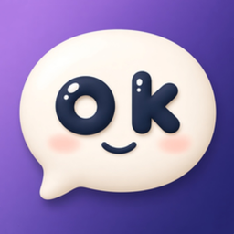

<h1>
  
  OkBot
</h1>

<p>
  <strong>English</strong> · <a href="./README_zh.md">中文</a>
</p>

[](https://github.com/shuzheng/okbot/releases/latest)
[](./LICENSE)
[](https://github.com/shuzheng/okbot/releases)
[](https://github.com/shuzheng/okbot/stargazers)
[](https://github.com/shuzheng/okbot/releases)

**OkBot is a local-first desktop Personal Agent.**  
AI as permanent contacts (persona + memory), real tools with human-in-the-loop, schedules, Squad + Mesh multi-agent, a personal gateway (`okbot serve`), and multi-computer execution. Bring your own models. MIT. Privacy under `~/.okbot` is supporting — not the only headline.

<!--  -->
<p align="center">
  <em>[Screenshot / GIF placeholder — desktop roster + chat]</em>
</p>

## What is a Personal Agent?

| | Chat tab / web chatbot | Coding harness / CLI plugin | **OkBot (Personal Agent)** |
| --- | --- | --- | --- |
| **Shape** | Answers in a box; session fades | Terminal / IDE for software work | Desktop app + optional headless gateway |
| **Identity** | Generic chat | Repo / task scoped | Named assistants with avatar, `SOUL.md`, memory |
| **Action** | Mostly text | Repo tools / patches | Shell, fs, web — with **HITL** approvals |
| **Multi-agent** | Rare | Coding-loop agent teams | **Squads** + **Mesh** (1:1 peer ask) |
| **Always-on** | Tab must be open | Invoke per task | Schedules + `okbot serve` |
| **Models** | Vendor locked or BYO | Usually BYO | **BYO** — OkBot hosts no inference |

## Features

- **Assistants as contacts** — name, avatar, persona (`SOUL.md`); chat like IM
- **Squad + Mesh** — squads collaborate on your task; 1:1 peers can ask each other
- **Shared packs** — export / import `.okbot`; gallery starters; public GitHub import
- **HITL tools** — shell, filesystem, web, and more, with approvals
- **Skills & memory** — progressive catalogs, hot-reload, cross-chat memory
- **Schedules** — wake on a schedule; manage jobs in the product UI
- **Personal gateway** — `okbot serve` headless, optional LAN Web UI
- **Remote computers** — `sandbox-agent` HTTP shell / fs on other hosts
- **BYO models** — connect providers you already use
- **Voice & observability** — on-device Whisper; light token stats and run logs

## Install (3 steps)

1. **Download** from **[GitHub Releases](https://github.com/shuzheng/okbot/releases/latest)**:

   | Platform | Artifact |
   | -------- | -------- |
   | macOS | `.dmg` / `.zip` (arm64 & x64) |
   | Windows | NSIS installer (x64) |
   | Linux | `.AppImage` (x64) |

2. **Open** OkBot (single-instance). Early builds may be **unsigned** — allow in system settings if you trust the download.

3. **Add a model provider**, **create an assistant**, and chat. Approve, remember, or deny tool requests as they appear.

Data directory: `~/.okbot/` on the gateway host.

## Documentation

Product behavior and developer notes: **[GUIDE.md](./GUIDE.md)**. Architecture: **[DESIGN.md](./DESIGN.md)** (when present in this release tree).

## Develop from source

Requires **Node ≥ 22.13** and **pnpm**:

```bash
pnpm install
pnpm approve-builds --all   # if pnpm 11 prompts about ignored build scripts
pnpm dev
```

## License

[MIT](./LICENSE) © 2026 张恕征
