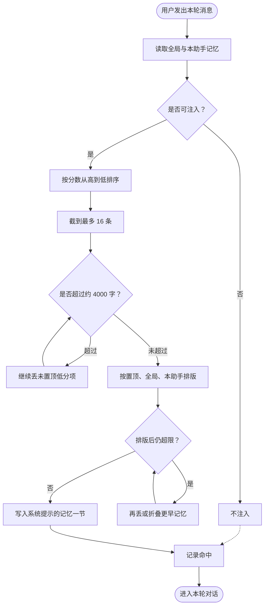

# 记忆加载算法

每轮开始回复时，系统如何从全局和当前助手的记忆里挑出最多 16 条（约 4000 字）写进系统提示。写入、合并、从被压缩的历史里抽取记忆不在这条路径里，也不改变当轮的选取结果。

磁盘上的字段与文件格式以 [`okbot-data-schema.md`](./okbot-data-schema.md) 为准。产品侧拼装时机见 [`GUIDE.md`](../../GUIDE.md) 中「instructions 各块」。

## 什么时候加载

助手每轮开始回复时，用本轮用户原话作为查询，从全局 `memory.md` 和当前助手目录下的 `memory.md` 加载。结果写进系统提示的「记忆」一节，不走会话历史压缩。默认最多注入 16 条、约 4000 字，均可在设置里改（`promptMaxEntries` / `promptMaxChars`）。

| 项 | 值 |
| --- | --- |
| 查询 | 本轮用户消息原文 |
| 条数上限 | 16（`promptMaxEntries`） |
| 字数上限 | 4000（`promptMaxChars`） |
| 存储 | 全局一份 `memory.md`，每个助手各一份 |

关键实现：`selectMemoriesForPrompt`（`packages/shared`）、`formatCappedMemoriesForPrompt`（网关）、`MemoryStore` 读盘。

## 加载流程

读盘时先删掉已过期的行。虚线是旁路：未进提示词的未置顶候选，如果和本轮问法有词面重合，最多还会记 8 次软命中，用来攒升级，当轮不注入。

## 谁可以被选进来

读盘时会先做懒惰清理：已过期的行从 `memory.md` 里删掉，不再参与筛选。剩下的条目里，只有满足下面一条的会进入打分池（`isMemoryInjectable`：已置顶，或已固化）。

| 类型 | 是否注入 | 说明 |
| --- | --- | --- |
| 已置顶（任何层级） | 是 | 优先级最高，尽量留在 16 条里 |
| 未置顶的已固化 | 是 | 按相关性和命中次数参与竞争 |
| 未置顶的候选 | 否 | 不进 16 条；有词面重合时可记软命中 |
| 已过期 | 否 | 加载时已从文件里删掉 |

新写下的记忆默认是候选。置顶后，或累计命中（含软命中）达到 2 次，会升成已固化，之后才能参与这 16 条的筛选。置顶会同时视为已固化。长时间不再命中的未置顶固化项，大约 90 天后会降回候选，不会直接删掉。置顶项不会因这条衰减或固化条数软封顶而被降级。

置顶不会因为命中次数自动发生。置顶来自 `manage_memory` 的 pin，或抽取/写入时把该条标成置顶。

## 打分

可注入的条目会合在一起打分，全局和本助手记忆用同一套公式，然后从高到低排序：

\\[
\\mathrm{score} = P + 100R + 3H + G + T
\\]

| 项 | 含义 | 权重 |
| --- | --- | --- |
| P | 已置顶为 1，否则为 0 | 乘 1,000,000，置顶始终排在最前 |
| R | 与本轮用户原话的词面重合，取值 0 到 1 | 乘 100 |
| H | 历史命中次数 | 乘 3 |
| G | 全局记忆为 1，本助手为 0 | 加 1，只用来稍微偏向全局 |
| T | 近期：最近命中时间，否则创建时间 | 近乎只用来打平手，权重很弱 |

相关性 R 是词面匹配：把查询和记忆文本切成词（中文还会取相邻两字），看查询里有多少词出现在记忆里，再除以查询词数。没有查询时 R 为 0，排序就主要靠置顶和命中次数。T 用时间戳除以 10 的 13 次方并限制在 0 到 1，对当前时间尺度几乎是平的，不要当成强近因子。

置顶在排序里绝对优先。超 16 条或约 4000 字时会先挤掉未置顶的已固化记忆；如果置顶本身超过上限，未置顶的固化记忆当轮进不去，多出来的置顶也会按更旧的先被丢掉或折成摘要。

## 两次裁剪

筛选分两步。第一步按分数决定谁进池；第二步把已选中的条目排成提示词文本时，可能再裁一次。

1. **按分数截取**（`selectMemoriesForPrompt`）：先截到最多 16 条，再按大约 4000 字的行长度往下丢。超限时先丢分数最低且未置顶的；只有全是置顶时才会丢置顶项。字数裁剪至少会留 1 条。
2. **排版时再检查一遍**（`formatCappedMemoriesForPrompt`）：已选中的条目会被重新排序：置顶的全局、置顶的本助手、未置顶的全局、未置顶的本助手，同组内新的排在前。这一步不再按分数排。若仍超条数上限，从尾部丢最早的未置顶项；若仍超字数上限，会先把更早的未置顶记忆折叠成一行摘要，还不够再硬丢。

最终出现在提示词里的顺序，不一定等于打分顺序。分数决定谁能进池；排版决定读者先看到谁。

## 排版与命中

写进系统提示时分两块：全局记忆和本助手记忆。每行带记忆 id，置顶项会标出，有到期时间的也会写上。

接着会记录命中：入选的条目都算一次命中；同时，未入选的未置顶候选里，和查询有词面重合的最多再取 8 条，记软命中。软命中不注入上下文，只用来累计次数，以后可能升成已固化。

若一条记忆设了过期时间且已到期，加载时会被删掉，置顶也保不住。
